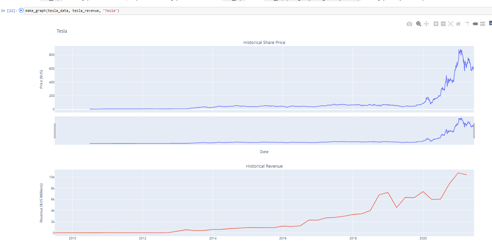

# Extracting and Visualizing Stock Data

My final project for IBM's *Python Project for Data Science* course. The notebook pulls historical share prices for Tesla and GameStop with `yfinance`, scrapes their quarterly revenue from Macrotrends with `requests` and BeautifulSoup, and plots price and revenue together on interactive Plotly dashboards.

| Step | What it does | Result |
|---|---|---|
| 1 | Tesla share price history with `yfinance` | [Q1.png](Q1.png) |
| 2 | Tesla quarterly revenue scraped from Macrotrends | [Q2.png](Q2.png) |
| 3 | GameStop share price history with `yfinance` | [Q3.png](Q3.png) |
| 4 | GameStop quarterly revenue scraped from Macrotrends | [Q4.png](Q4.png) |
| 5 | Tesla dashboard: share price and revenue | [Q5.png](Q5.png) |
| 6 | GameStop dashboard: share price and revenue | [Q6.png](Q6.png) |

## Running it

Open [`stock_analysis.ipynb`](stock_analysis.ipynb) in Jupyter. It needs `yfinance`, `pandas`, `requests`, `beautifulsoup4`, `html5lib` and `plotly`. The saved outputs show the results from when the project was completed in 2023; Macrotrends has since changed its pages, so the scraping steps may need adjusting to run today.

## License

MIT. See [LICENSE](LICENSE).
